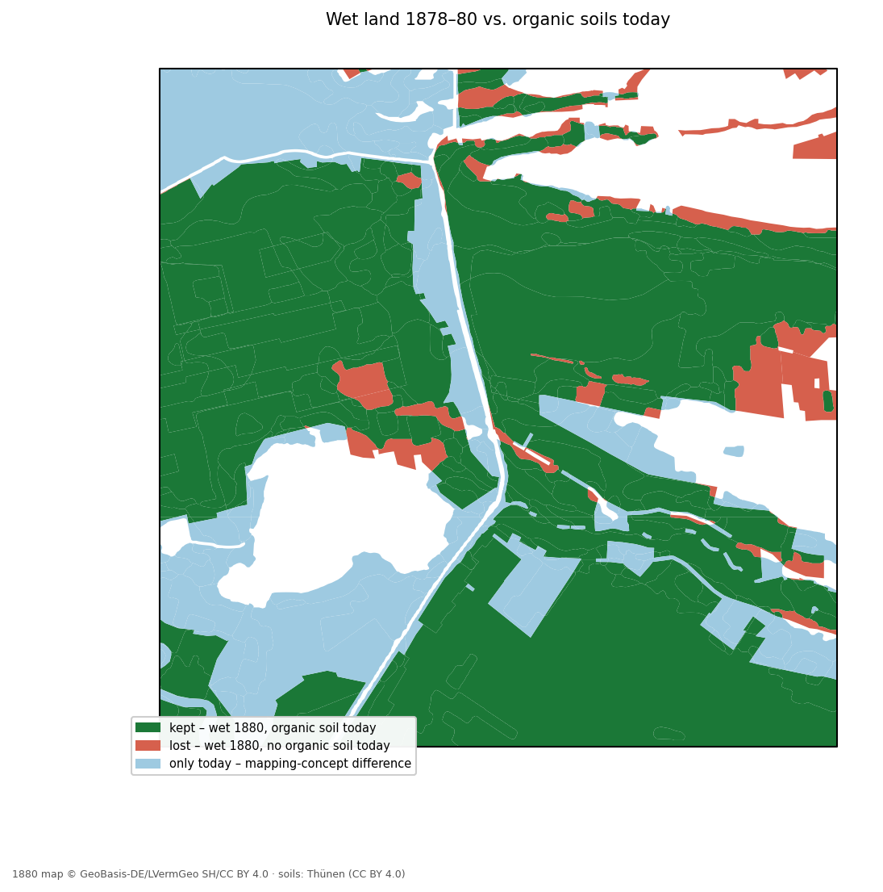

# Peatland rewetting in Schleswig-Holstein

Where are the peat soils in Schleswig-Holstein, how are they used, how much do they emit – and where would rewetting make the most sense?

A QGIS / open-source portfolio project by **Bonnie Winter** (2026).

> All emission figures are **estimates** (area × national emission factors) and are labelled as such. Everything was run on a **test area** of 304 km² around the Sorge lowland (Meggerdorf, Bergenhusen, Tetenhusen); `TEST_MODE = False` in `config.py` runs the same steps for the whole state.

## Context

According to the Land Schleswig-Holstein (Moor-Klimaschutz, Jan 2024), carbon-rich soils cover about 152,800 ha (≈10 % of the state), more than 81 % of them are used for agriculture, and they cause about 17 % of the state's greenhouse gas emissions.

## Key results (test area)

| Question | Result | Step |
|---|---|---|
| How much farmland lies on organic soil? | **11,102 ha** – 10,824 ha grassland, 278 ha cropland | 03 |
| How much does it emit? | **≈ 354,000 t CO2-eq/yr** (estimate); ≈ 293,000 t/yr could be saved by rewetting all of it | 04 |
| How uncertain is that? | 90 % range 351,000–358,000 t if field-level errors cancel out, 144,000–487,000 t if the whole area deviates from the German average – the truth lies in between | 08 |
| Where should rewetting start? | To save 75,000 t/yr: choosing **82 whole sub-catchments** wets only **52 ha** of farmland on mineral soil – choosing the best **parcels** instead touches 119–230 catchments and wets **4,300–6,600 ha** of mineral-soil farmland as a side effect | 05, 07 |
| Can the 1880 map be read automatically? | A small **YOLO26** model, trained on my own computer with 32 hand-labelled tiles (400 tufts, 25 peat cuttings), plus rule-based dash detection reproduces the hand digitising on **90 %** of the area it was not tuned on (Cohen's κ = 0.85) | 06x–06c |
| How has the wet land changed since 1880? | In a 36 km² block, **92 %** of the land shown as wet on the 1878–80 map is still organic soil today; 1880 *Moor* ≈ today's raised bog; about **a third of the 1880 wet meadows are now Moorfolgeboden** (peat largely lost); 721 ha of today's fen were already drained pasture or dry meadow in 1880 | 06 |



## Methods

| Step | Script | Method | Tools |
|---|---|---|---|
| 00 | `00_check_inputs.py` | Inventory of inputs: CRS, fields, example values | GeoPandas, pyogrio |
| 01 | `01_prepare_dgm1.py` | 355 DGM1 tiles via the official bulk-download index, XYZ → GeoTIFF, survey years | GDAL, urllib + truststore |
| 02 | `02_prepare_inputs.py` | Reproject, repair, clip to AOI → one GeoPackage | GeoPandas |
| 03 | `03_overlay_soils_landuse.py` | Organic soils × arable/grassland (Feldblöcke 2026), per municipality | GeoPandas |
| 04 | `04_emission_estimate.py` | Area × implied emission factors (Tiemeyer et al. 2020) | pandas |
| 05 | `05_hydrology.py` | DEM at 5 m (min), flow accumulation, streams, 367 sub-catchments | GRASS `r.watershed` via `qgis_process` |
| 06 | `06_historical_loss.py` | Wet signatures hand-digitised from the Preußische Landesaufnahme 1878–80 vs. today's soil map | QGIS, GeoPandas, Shapely |
| 07 | `07_optimisation.py` | Minimum area for a CO2 target: parcel ranking, parcel optimum, catchment optimum | SciPy `milp` / HiGHS (binary integer programming) |
| 08 | `08_monte_carlo.py` | 10,000 runs, skewed (two-piece normal) emission factors, two correlation scenarios | NumPy, SciPy |
| 09 | `09_export_maps_pyqgis.py` | Atlas: one A4 page per municipality with ≥ 50 ha farmed peat (24 pages) – [web version](outputs/maps/atlas_gemeinden_web.pdf) | PyQGIS |

Each step writes a short report to [`docs/reports/`](docs/reports/). A 26-page explanation of the whole project is in [`docs/peatland_project_report_2026-10-26.pdf`](docs/peatland_project_report_2026-10-26.pdf).

### Historical map (step 06)

The 1878–80 sheets were digitised by hand at 1:2,500–1:5,000, recording the legend class the map shows rather than an interpretation:

| hist_type | 1898 legend entry | Peat evidence |
|---|---|---|
| Moor | Sumpf, Bruch, Moor (tufts + dashes, Torfstich) | certain |
| nasser Boden / nasse Wiese | wet ground / wet meadow | likely |
| Heide | heath, lowland only | possible |

Pasture (*Hutung*), dry meadow, sand, arable land and villages were not digitised. Symbol meanings come from the official *Zeichen-Erklärung für die Messtischblätter* (1898) – see [`docs/digitising_legend.png`](docs/digitising_legend.png) and the rules in [`docs/historical_peat_digitising_rules.xlsx`](docs/historical_peat_digitising_rules.xlsx). The comparison only covers the area that was actually checked (`digitised_extent`). Closing road/ditch gaps of 15 m vs. 30 m changes every category by ≤ 1 %.

### Reading the 1880 map automatically (steps 06x–06c)

Hand digitising doesn't scale beyond a few sheets, so I tested whether the same classes can be derived automatically. Everything runs locally on a CPU.

| Step | Script | What it does |
|---|---|---|
| 06x | `06x_make_tiles.py` | 1 m GeoTIFF of the block (WCS) → 361 tiles of 320 m, enlarged to 640 px so a tuft becomes ~25 px |
| – | QGIS | I labelled every tuft (point) and peat cutting (*Torfstich*, rectangle) in 32 tiles, incl. 11 tiles without symbols |
| 06y | `06y_labels_to_yolo.py` | labels → YOLO format; spatial split 24 / 4 / 4 tiles (edge-neighbours kept together, stratified by content) |
| – | Ultralytics | `yolo26n`, CPU, `scale=0.2` (keeps the tiny symbols from being shrunk further), stopped early at epoch 124 |
| 06z | `06z_point_check.py` | point-based check: a symbol counts as found if a detection lies within 8 m |
| 06b | `06b_predict.py` | detections on all 361 tiles, duplicates merged → map coordinates |
| 06c | `06c_detections_to_polygons.py` | dash filter + tufts + Torfstich → 1880 classes on a 25 m grid; tuned on the west half, checked on the east half |

**Symbol detection** (4 test tiles never used for training, confidence ≥ 0.20, before merging duplicates): tufts recall 0.75 / precision 0.59; Torfstich 3 of 4 found. The model finds most tufts but with low confidence, so the threshold matters more than the usual default.

**Dashes** are found without machine learning: flat ink marks (≤ 3 m high, 5–40 m long) are the dashes of *Bruch* and *nasse Wiese*, while dotted pasture rows, lettering, buildings and field lines fall outside these limits. Dash density alone separates wet from not-wet land almost as well as the hand digitising (AUC 0.97).

**Rules** are those of the hand digitising: tufts + dashes → Moor; recurring Torfstich → Moor; dashes only → nasse Wiese; heath tufts touching Moor or near recurring Torfstich → Moor ("heath in a moor"). The last rule was added after a first run classified the drained Königsmoor as heath (κ 0.76 → 0.85); it comes from the digitising rules, not from the check data.

| Area | Agreement with hand digitising | κ |
|---|---:|---:|
| west half (used for tuning) | 84 % | 0.74 |
| **east half (not used)** | **90 %** | **0.85** |


On the east half, Moor is reproduced with an IoU of 0.90 and nasse Wiese with 0.76 (the automation draws nasse Wiese slightly too wide, into dense pasture rows); the small Heide class (29 ha) is not reproduced, and moor names are not detected. Plan and labelling guide: [`docs/yolo_plan.md`](docs/yolo_plan.md), [`docs/labelling_guide.png`](docs/labelling_guide.png). Ultralytics is licensed under AGPL-3.0.

## Repository structure

```
config.py            all paths, fields, parameters, emission factors
peatsh/common.py     shared helpers (AOI, clipping, GeoPackage I/O, reports)
scripts/             numbered steps 00–09 (06x–06c: automated reading of the 1880 map)
qgis/                QGIS project, styles (.qml)
data/raw/            downloads and hand-digitised layers – not in git
data/interim/        intermediate rasters, map tiles, YOLO dataset and model – not in git
data/processed/      peatland_sh.gpkg – not in git
outputs/             maps, figures, CSV tables
docs/                reports per step, project report, digitising legend and rules
```

## How to run

Developed with the Python that ships with **QGIS LTR** on Windows (GeoPandas, GDAL, SciPy, matplotlib included), run from the OSGeo4W Shell:

```bat
python -m pip install --user pulp tabulate truststore
python scripts\00_check_inputs.py
python scripts\01_prepare_dgm1.py
python scripts\02_prepare_inputs.py
python scripts\03_overlay_soils_landuse.py
python scripts\04_emission_estimate.py
python scripts\05_hydrology.py        :: needs: qgis_process-qgis-ltr plugins enable grassprovider
python scripts\06_historical_loss.py  :: needs the hand-digitised layer in data\raw\historical\
python scripts\07_optimisation.py
python scripts\08_monte_carlo.py
```

Step 09 runs inside QGIS (Python console). The YOLO steps use a separate environment (`python -m venv yolo-env`, then `pip install ultralytics` with the CPU build of PyTorch): 06x, 06y and 06c run in the OSGeo4W Shell, training, 06z and 06b in `yolo-env`. Alternatively, `environment.yml` describes an equivalent conda environment. Data downloads are listed in [DATA_SOURCES.md](DATA_SOURCES.md).

## Limitations

- Emission factors are national class averages; water level, peat thickness and management within a class are ignored.
- The DEM does not show pipe drains, culverts or pumping stations, which control water in fen landscapes; the test area is a hand-drawn polygon, not a real catchment, so only complete sub-catchments are used.
- The historical comparison sets map *signatures* against a *soil* map – different concepts. Hand digitising, the positional accuracy of the 1880 survey and a legend ~20 years younger than the sheets add uncertainty; about a third of the "lost" area lies within 25 m of a boundary.
- DGM1 tiles come from survey years 2005–2025; drained peat subsides, so tile edges can show small steps.
- The YOLO model was trained on 32 tiles from the same 36 km² block it was evaluated on (different tiles, but the same map sheet and engraver); other sheets need spot checks before it is applied there.

## Data and licences

See [DATA_SOURCES.md](DATA_SOURCES.md). Code was written with AI assistance; every step was run and checked by me.
