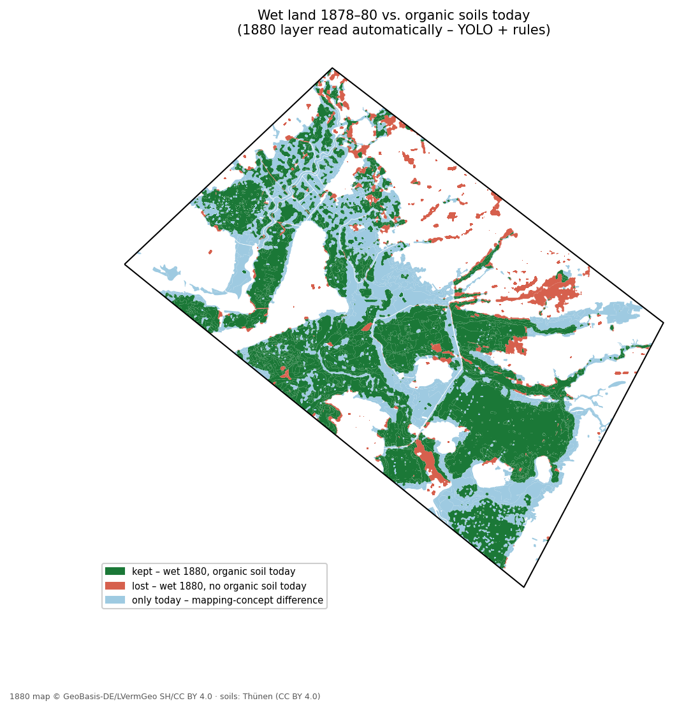
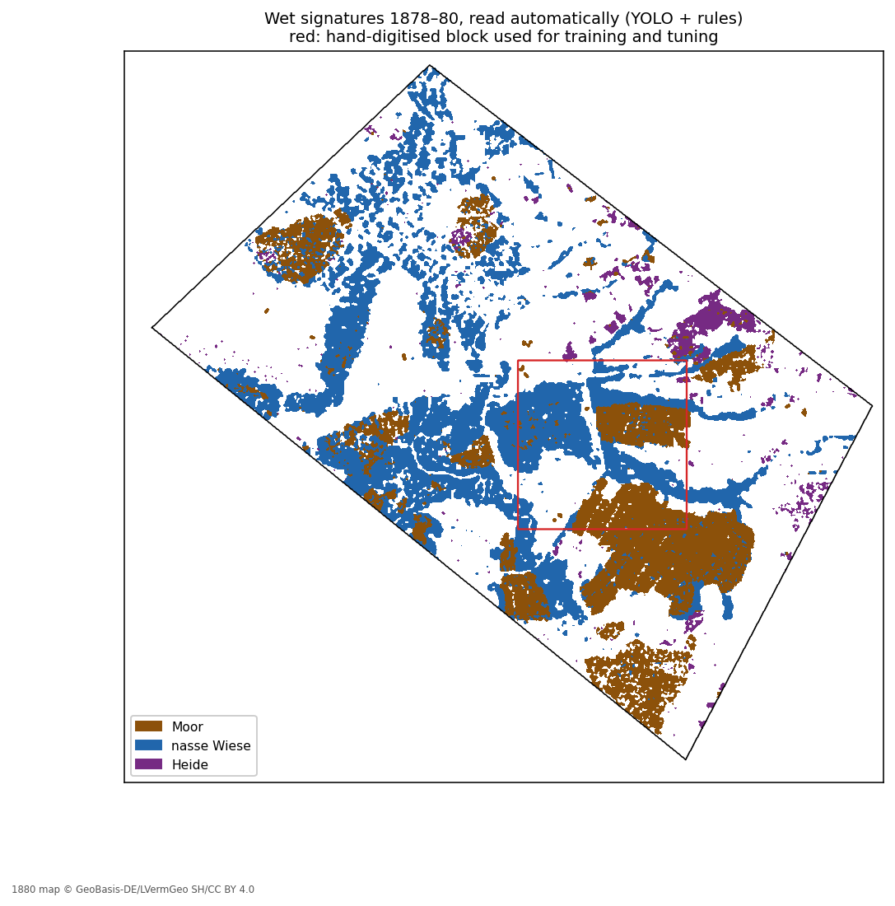

# Peatland rewetting in Schleswig-Holstein

Where are the peat soils in Schleswig-Holstein, how are they used, how much do they emit – and where would rewetting make the most sense?

A QGIS / open-source portfolio project by **Bonnie Winter** (2026).

> All emission figures are **estimates** (area × national emission factors) and are labelled as such. Everything was run on a **test area** of 304 km² around the Sorge lowland (Meggerdorf, Bergenhusen, Tetenhusen); `TEST_MODE = False` in `config.py` runs the same steps for the whole state.

## Context

According to the Land Schleswig-Holstein (Moor-Klimaschutz, Jan 2024), carbon-rich soils cover about 152,800 ha (≈10 % of the state), more than 81 % of them are used for agriculture, and they cause about 17 % of the state's greenhouse gas emissions.

## Key results (test area)

| Question | Result | Step |
|---|---|---|
| How much farmland lies on organic soil? | **11,102 ha** – 10,824 ha grassland, 278 ha cropland | 03 |
| How much does it emit? | **≈ 354,000 t CO2-eq/yr** (estimate); ≈ 293,000 t/yr could be saved by rewetting all of it | 04 |
| How uncertain is that? | 90 % range 351,000–358,000 t if field-level errors cancel out, 144,000–487,000 t if the whole area deviates from the German average – the truth lies in between | 08 |
| Where should rewetting start? | To save 75,000 t/yr: choosing **78 whole sub-catchments** wets only **44 ha** of farmland on mineral soil – choosing the best **parcels** instead touches 121–220 catchments and wets **4,500–7,200 ha** of mineral-soil farmland as a side effect | 05, 07 |
| Can the 1880 map be read automatically? | A small **YOLO26** model, trained on my own computer with hand-labelled tiles, plus rule-based dash detection reproduces my hand digitising on **91 %** of the area it was not tuned on (κ = 0.87) – and reaches **93 % ± 4 %** accuracy (area-weighted) in a blind 100-point check across the rest of the test area | 06x–06v |
| How has the wet land changed since 1880? | Hand-digitised block (36 km²): **92 %** of the land shown as wet on the 1878–80 map is still organic soil today. Whole test area (304 km², automated): **88 %** (10,441 of 11,872 ha). 1880 *Moor* ≈ today's raised bog; a fifth to a third of the 1880 wet meadows are now **Moorfolgeboden** (peat largely lost); about 5,500 ha of today's fen were already drained pasture or dry meadow in 1880 | 06 |
| Were the chosen sub-catchments wet in 1880? | Yes: **68 %** of the area of the 78 chosen sub-catchments was wet on the 1878–80 map, against 40 % of the other candidates – although step 07 knew nothing about 1880. Preferring land that was wet in 1880 raises that share of the rewetted farmed peat from 66 % to 85 %, at the cost of ~90 ha more mineral-soil farmland | 07b |



## Methods

| Step | Script | Method | Tools |
|---|---|---|---|
| 00 | `00_check_inputs.py` | Inventory of inputs: CRS, fields, example values | GeoPandas, pyogrio |
| 01 | `01_prepare_dgm1.py` | 355 DGM1 tiles via the official bulk-download index, XYZ → GeoTIFF, survey years | GDAL, urllib + truststore |
| 02 | `02_prepare_inputs.py` | Reproject, repair, clip to AOI → one GeoPackage | GeoPandas |
| 03 | `03_overlay_soils_landuse.py` | Organic soils × arable/grassland (Feldblöcke 2026), per municipality | GeoPandas |
| 04 | `04_emission_estimate.py` | Area × implied emission factors (Tiemeyer et al. 2020) | pandas |
| 05 | `05_hydrology.py` | DEM at 5 m (min), official water-body network burned 3 m deep (stream burning), flow accumulation, streams, 350 sub-catchments | GDAL, GRASS `r.watershed` via `qgis_process` |
| 06 | `06_historical_loss.py` | Wet signatures from the Preußische Landesaufnahme 1878–80 vs. today's soil map – hand-digitised block, or the automated layer for the whole test area (`yolo`) | QGIS, GeoPandas, Shapely |
| 07 | `07_optimisation.py` | Minimum area for a CO2 target: parcel ranking, parcel optimum, catchment optimum | SciPy `milp` / HiGHS (binary integer programming) |
| 07b | `07b_history_per_catchment.py` | The 1880 map per sub-catchment: wet share, Moorfolgeboden, chosen vs. other catchments, sensitivity run of 07 that prefers land wet in 1880 | GeoPandas, SciPy `milp` |
| 08 | `08_monte_carlo.py` | 10,000 runs, skewed (two-piece normal) emission factors, two correlation scenarios | NumPy, SciPy |
| 09 | `09_export_maps_pyqgis.py` | Atlas: one A4 page per municipality with ≥ 50 ha farmed peat (24 pages) – [web version](docs/atlas_gemeinden_web.pdf) | PyQGIS |

**Stream burning (step 05).** In flat fen land many ditches are narrower than a 5 m cell or run through culverts, so a flow model on the bare DEM draws streams beside the real watercourses. I lower the DEM by 3 m along the official water-body network (ATKIS Basis-DLM, 1,885 km of lines in the test area, many of them field ditches) before running `r.watershed`. The modelled streams now follow the rivers and ditches; the number of sub-catchments drops from 367 to 350, and the CO2 target in step 07 is reached with 78 instead of 82 of them. Wide rivers are burned only along their centre line, so a second, parallel stream can remain inside the river bed.

Each step writes a short report to [`docs/reports/`](docs/reports/). A 40-page explanation of the whole project is in [`docs/peatland_project_report_2026-10-26.pdf`](docs/peatland_project_report_2026-10-26.pdf).

### Historical map (step 06)

The 1878–80 sheets were digitised by hand at 1:2,500–1:5,000, recording the legend class the map shows rather than an interpretation:

| hist_type | 1898 legend entry | Peat evidence |
|---|---|---|
| Moor | Sumpf, Bruch, Moor (tufts + dashes, Torfstich) | certain |
| nasser Boden / nasse Wiese | wet ground / wet meadow | likely |
| Heide | heath, lowland only | possible |

Pasture (*Hutung*), dry meadow, sand, arable land and villages were not digitised. Symbol meanings come from the official *Zeichen-Erklärung für die Messtischblätter* (1898) – see [`docs/digitising_legend.png`](docs/digitising_legend.png) and the rules in [`docs/historical_peat_digitising_rules.xlsx`](docs/historical_peat_digitising_rules.xlsx). The comparison only covers the area that was actually checked (`digitised_extent`). Closing road/ditch gaps of 15 m vs. 30 m changes every category by ≤ 1 %.

### Reading the 1880 map automatically (steps 06x–06c)

Hand digitising doesn't scale beyond a few sheets, so I tested whether the same classes can be derived automatically. Everything runs locally on a CPU.

| Step | Script | What it does |
|---|---|---|
| 06x | `06x_make_tiles.py` | 1 m GeoTIFF of the block (WCS) → 361 tiles of 320 m, enlarged to 640 px so a tuft becomes ~25 px |
| – | QGIS | I labelled every tuft (point) and peat cutting (*Torfstich*, rectangle) in 32 tiles, incl. 11 tiles without symbols |
| 06y | `06y_labels_to_yolo.py` | labels → YOLO format; spatial split 24 / 4 / 4 tiles (edge-neighbours kept together, stratified by content) |
| – | Ultralytics | `yolo26n`, CPU, `scale=0.2` (keeps the tiny symbols from being shrunk further), stopped early at epoch 124 |
| 06z | `06z_point_check.py` | point-based check: a symbol counts as found if a detection lies within 8 m |
| 06b | `06b_predict.py` | detections on all 361 tiles, duplicates merged → map coordinates |
| 06c | `06c_detections_to_polygons.py` | dash filter + tufts + Torfstich → 1880 classes on a 25 m grid; tuned on the west half, checked on the east half |
| 06v | `06v_accuracy_check.py` | blind accuracy check: 100 stratified random points outside the block, read by me from the map, area-weighted accuracy (Olofsson et al. 2014) |

**Symbol detection** (4 test tiles never used for training, confidence ≥ 0.20, before merging duplicates): tufts recall 0.75 / precision 0.59; Torfstich 3 of 4 found. The model finds most tufts but with low confidence, so the threshold matters more than the usual default.

**Dashes** are found without machine learning: flat ink marks (≤ 3 m high, 5–40 m long) are the dashes of *Bruch* and *nasse Wiese*, while dotted pasture rows, lettering, buildings and field lines fall outside these limits. Dash density alone separates wet from not-wet land almost as well as the hand digitising (AUC 0.97).

**Rules** are those of the hand digitising: tufts + dashes → Moor; recurring Torfstich → Moor; dashes only → nasse Wiese; heath next to recurring Torfstich or joined to a larger moor → Moor ("heath in a moor"). The last rule was added after a first run classified the drained Königsmoor as heath (κ 0.76 → 0.85); it comes from the digitising rules, not from the check data.

| Area | Agreement with hand digitising | κ |
|---|---:|---:|
| west half (used for tuning) | 84 % | 0.74 |
| **east half (not used)** | **91 %** | **0.87** |


On the east half, Moor is reproduced with an IoU of 0.91 and nasse Wiese with 0.76 (the automation draws nasse Wiese slightly too wide, into dense pasture rows); the small Heide class (29 ha) is hardly reproduced, and moor names are not detected. Plan and labelling guide: [`docs/yolo_plan.md`](docs/yolo_plan.md), [`docs/labelling_guide.png`](docs/labelling_guide.png). Ultralytics is licensed under AGPL-3.0.

### Applying it to the whole test area

The same model and the thresholds tuned on the block (no re-tuning) were applied to the whole test area: 3,119 tiles, about 20 minutes on a laptop CPU. Inside the block the result still agrees with my hand digitising on 87 % (κ 0.81). The final layer uses the tufts of the first model and the peat cuttings of the second (11,943 tufts, 1,129 peat cuttings), and measures dash density per field – see *Second training round* and *Dash density per field* below.



Twelve spot-check tiles outside the block showed no false detections on lettering, field lines or villages, but missed peat cuttings at a steep angle and some larger tufts drawn in a different style. A first run turned a dry heath near Friedrichsneuland into Moor, because tuft base lines counted as dashes and the "heath in a moor" rule spread across the whole heath. I fixed both (base lines within 10 m of a tuft are ignored; heath only joins a moor at least as large as itself); on the block this leaves the check result unchanged (κ 0.85 → 0.86). Automated Heide is left out of the 1880 wet land, as it is mostly geest heath.

**Blind accuracy check** (`06v`): 100 random points outside the block, 25 per mapped class, which I classified from the 1880 map without seeing the prediction.

| Class | Mapped ha | User's accuracy | Producer's accuracy | Estimated ha (± 95 %) |
|---|---:|---:|---:|---:|
| Moor | 3,690 | 0.89 | 0.93 | 3,714 ± 726 |
| nasse Wiese | 5,881 | 0.86 | 0.86 | 4,754 ± 1,668 |
| Heide | 831 | 0.89 | 0.78 | 910 ± 393 |
| none | 16,356 | 0.96 | 0.96 | 17,381 ± 1,605 |
| **Overall accuracy** | | **93 % ± 4 %** | | |

Moor is reliable; nasse Wiese is still the least certain class, so the "lost" area of the whole-area comparison (1,431 ha) is an upper bound.

### Second training round

The spot checks showed three weak points: peat cuttings drawn diagonally or horizontally, large fan-shaped tufts, and nasse Wiese spreading into pasture rows. I labelled 10 more tiles outside the block that cover the first two (181 tufts, 36 peat cuttings), chosen away from the 100 check points so that the blind check stays independent. They were added to training only; validation and test tiles stayed the same. The model was retrained with moderate rotation (±30°, no vertical flip – tufts are always drawn upright). The pasture rows are a problem of the dash rule, not of the model, so more labels cannot fix them.

| Blind check, 100 points | Round 1 | Round 2 | Round 1 tufts + round 2 peat cuttings |
|---|---:|---:|---:|
| Overall accuracy | 90 % ± 6 % | 90 % ± 6 % | **91 % ± 6 %** |
| Moor, user's / producer's acc. | 0.92 / 0.86 | 0.84 / 0.89 | 0.90 / 0.93 |
| Heide, user's / producer's acc. | 0.84 / 0.69 | 0.92 / 0.78 | 0.89 / 0.81 |
| Block, east half (κ) | 0.86 | 0.86 | 0.86 |

What happened: the second model finds peat cuttings much better (all 6 on the validation and test tiles, 46 % more on the whole area), but its tuft confidences cluster around 0.15–0.25, so the result swings with the threshold – at 0.15 it also "finds" tufts in dashed meadows, and tufts + dashes become false Moor. Training longer did not change that. A stricter peat-cutting rule (now tuned on the block: ≥ 3 cuttings per 275 m instead of 2) hardly changed anything, which showed that the false Moor came from the tufts, not the peat cuttings. Taking each symbol from the model that is reliable for it gives the best map. The gain is within the confidence interval, and the combination is the third variant checked against the same 100 points, so I read it as "slightly better, not significantly better". Comparing a new map with a sample drawn from an older one uses the estimator for strata that differ from the map classes (Stehman 2014; `06v_accuracy_check.py compare`).

### Dash density per field

The remaining nasse Wiese errors sat in **dry meadow** (*trockene Wiese*, rows of dot pairs). The dot pairs themselves were correctly ignored – but the dash density was averaged over a 125 m moving window, which reached across the field line into a neighbouring wet meadow. The surveyors drew one signature per field, so I now let the map's own field lines (ink longer than 80 m) split the land into fields and compute the dash density inside each field; tiny slivers and large open areas keep the window value. 06c tries both methods on the west half of the block.

| Dash density | κ west (tuning) | κ east (check) |
|---|---:|---:|
| moving window | 0.740 | 0.856 |
| per field | 0.736 | **0.866** |

The two were equal on the west half, so I set a rule **before** looking at the check points: within 0.01 κ, the field method wins, because it follows the digitising rule "boundaries follow the field line". In the blind check it fixes two of the three dry-meadow errors but misses three sparse wet meadows; 87 instead of 88 of the 100 points are right, while the area-weighted accuracy rises from 91 % to 93 % because one corrected point carries a large weight. Overall: about as accurate, with boundaries that follow the fields as they were drawn.

## Repository structure

```
config.py            all paths, fields, parameters, emission factors
peatsh/common.py     shared helpers (AOI, clipping, GeoPackage I/O, reports)
scripts/             numbered steps 00–09 (06x–06c: automated reading of the 1880 map)
qgis/                QGIS project, styles (.qml)
data/raw/            downloads and hand-digitised layers – not in git
data/interim/        intermediate rasters, map tiles, YOLO dataset and model – not in git
data/processed/      peatland_sh.gpkg – not in git
outputs/             maps, figures, CSV tables
docs/                reports per step, project report, digitising legend and rules
```

## How to run

Developed with the Python that ships with **QGIS LTR** on Windows (GeoPandas, GDAL, SciPy, matplotlib included), run from the OSGeo4W Shell:

```bat
python -m pip install --user pulp tabulate truststore
python scripts\00_check_inputs.py
python scripts\01_prepare_dgm1.py
python scripts\02_prepare_inputs.py
python scripts\03_overlay_soils_landuse.py
python scripts\04_emission_estimate.py
python scripts\05_hydrology.py        :: needs: qgis_process-qgis-ltr plugins enable grassprovider
python scripts\06_historical_loss.py  :: needs the hand-digitised layer in data\raw\historical\
python scripts\07_optimisation.py
python scripts\07b_history_per_catchment.py  :: after 06 yolo
python scripts\08_monte_carlo.py
```

Step 09 runs inside QGIS (Python console). The YOLO steps use a separate environment (`python -m venv yolo-env`, then `pip install ultralytics` with the CPU build of PyTorch); 06x, 06y, 06c, 06v and 06 run in the OSGeo4W Shell, training, 06z and 06b in `yolo-env`:

```bat
:: block: tiles, labels → dataset, training, check, tuning
python scripts\06x_make_tiles.py
python scripts\06y_labels_to_yolo.py
yolo detect train data=dataset/data.yaml model=yolo26n.pt imgsz=640 epochs=300 patience=80 batch=8 device=cpu workers=0 scale=0.2
python scripts\06b_predict.py
python scripts\06c_detections_to_polygons.py
:: whole test area: same model and thresholds
python scripts\06x_make_tiles.py aoi
python scripts\06b_predict.py aoi
python scripts\06c_detections_to_polygons.py aoi
python scripts\06_historical_loss.py yolo
python scripts\06v_accuracy_check.py make   :: then fill "ref" in QGIS
python scripts\06v_accuracy_check.py eval
:: second round: label more tiles in tiles_aoi.gpkg (use = 'label'), then
python scripts\06y_labels_to_yolo.py
yolo detect train data=dataset/data.yaml model=yolo26n.pt imgsz=640 epochs=150 patience=40 batch=8 device=cpu workers=2 scale=0.2 degrees=30 flipud=0 project=runs name=train3
python scripts\06b_predict.py aoi data\interim\yolo\runs\detect\runs\train3\weights\best.pt 0.15/0.20
python scripts\06v_accuracy_check.py compare data\interim\yolo\round1\yolo_classes_aoi.tif
:: final map: round-1 tufts + round-2 peat cuttings in detections*.csv, then 06c, 06c aoi, 06 yolo, 07b
``` Alternatively, `environment.yml` describes an equivalent conda environment. Data downloads are listed in [DATA_SOURCES.md](DATA_SOURCES.md).

## Limitations

- Emission factors are national class averages; water level, peat thickness and management within a class are ignored.
- The DEM does not show pipe drains, culverts or pumping stations, which control water in fen landscapes; the test area is a hand-drawn polygon, not a real catchment, so only complete sub-catchments are used.
- The historical comparison sets map *signatures* against a *soil* map – different concepts. Hand digitising, the positional accuracy of the 1880 survey and a legend ~20 years younger than the sheets add uncertainty; about a third of the "lost" area lies within 25 m of a boundary.
- DGM1 tiles come from survey years 2005–2025; drained peat subsides, so tile edges can show small steps.
- The YOLO models were trained on 42 tiles, 32 of them from one 36 km² block. Across the whole test area the map reaches 93 % ± 4 % accuracy (100 blind points; the final map is the result of choosing between several variants checked against these points, so this figure is slightly optimistic), nasse Wiese is the least certain class (user's accuracy 0.86), the second model's tuft confidences are unstable, and moor names are not read. Land around peat cuttings is mapped as squares rather than whole fields. The rules were tuned on one block; other parts of the state (marsh, raised bogs, eastern hills) would need their own checks.
- Stream burning uses the centre lines of the water-body network; wide rivers and pipe drains are not represented.

## Data and licences

See [DATA_SOURCES.md](DATA_SOURCES.md). Code was written with AI assistance; every step was run and checked by me.
