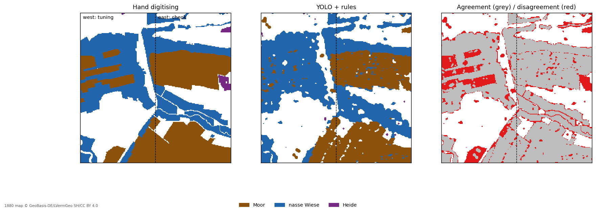

# 06c_yolo_vs_hand – Automated 1880 classes vs. hand digitising

_Run: 2026-10-27 12:30 · TEST MODE (test_catchment)_

- detections used: 2203 tufts, 110 Torfstich (from 06b)
- dash components (flat, 5–40 m): 24,122
- grid 25 m, dash window 125 m, tuft window 75 m
- tuned on the west half: **tufts ≥ 1** per 75 m window, **dash density ≥ 0.280**, heath within **100 m** of recurring Torfstich (or joined to a larger Moor) → Moor; **recurring Torfstich = ≥ 3 chains per 275 m**, Moor within **62 m**

| area          | agreement   |   kappa |
|:--------------|:------------|--------:|
| west (tuning) | 84%         |    0.74 |
| east (check)  | 91%         |    0.86 |
| whole block   | 87%         |    0.81 |

Kappa: agreement beyond chance (0 = chance, 1 = perfect). The east half was not used for tuning – its value is the honest one.

### Confusion matrix, east half (ha)

|                   |   YOLO: – |   YOLO: Moor |   YOLO: nasse Wiese |   YOLO: Heide |
|:------------------|----------:|-------------:|--------------------:|--------------:|
| hand: –           |       537 |           11 |                  77 |             3 |
| hand: Moor        |        16 |          710 |                  20 |             0 |
| hand: nasse Wiese |        19 |            3 |                 376 |             0 |
| hand: Heide       |         2 |           19 |                   0 |             6 |

### Per class (east half)

| class | IoU | area hand ha (block) | area YOLO ha (block) |
|---|---:|---:|---:|
| Moor | 0.91 | 1,084 | 906 |
| nasse Wiese | 0.76 | 1,060 | 1,247 |
| Heide | 0.21 | 29 | 12 |

Limitations: names ('…moor') are not detected; the YOLO model was trained on 32 tiles of the same block (some overlap with the evaluated area); Hutung/trockene Wiese are not separated (both count as '–'); the small Heide class (29 ha by hand) is hardly reproduced.
