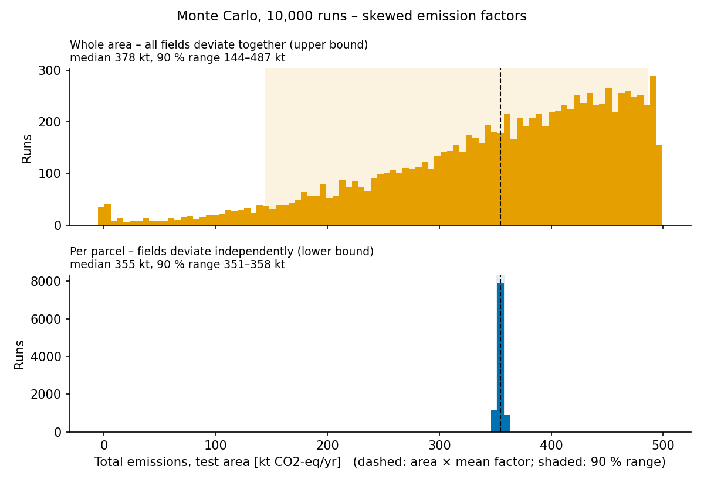

# 08_monte_carlo – Uncertainty of the emission estimate

_Run: 2026-10-23 11:40 · TEST MODE (test_catchment)_

- runs: 10,000, seed 42, distribution: **skewed**
- deterministic estimate (area × mean factor): 354,350 t CO2-eq/yr
- parcels in per-parcel scenario: 4,438

| scenario | emissions median | 90 % range | savings median | 90 % range |
|---|---|---|---|---|
| whole area (upper bound) | 377,750 | 143,853 – 486,858 | 313,018 | 76,205 – 447,116 |
| per parcel (lower bound) | 354,681 | 350,943 – 358,406 | 293,210 | 289,232 – 297,117 |

Emission factors drawn [t CO2-eq/ha/yr] (Tiemeyer et al. 2020: mean from
Table 5, spread from the Table 2 percentiles). For drained land the
distribution is lopsided: most hectares sit just below a ceiling (the CO2
response levels off at deep drainage), with a long tail towards wetter,
lower-emitting fields.

| class | mean | per-hectare 2.5–97.5 % (drawn) | fit error |
|---|---|---|---|
| cropland | 40.4 | 21.9 – 50.2 | 0.68 t C |
| grassland | 31.8 | 7.9 – 44.4 | 0.75 t C |
| rewetted | 5.5 | -1.8 – 11.7 | 0.00 t C |

How to read this: the paper's ranges describe how much single hectares
differ (mainly water table), not the uncertainty of an area average.
If all fields in the test area deviated in the same direction (e.g. the
whole region is wetter than the German average), the orange range applies.
If fields deviated independently, errors cancel out (blue range). Reality
lies in between, because neighbouring fields share ditches and pumping.
Local water-table data would narrow this down.

Not included: area/mapping errors, uncertainty of the response functions
themselves, GWP choice (AR4).

